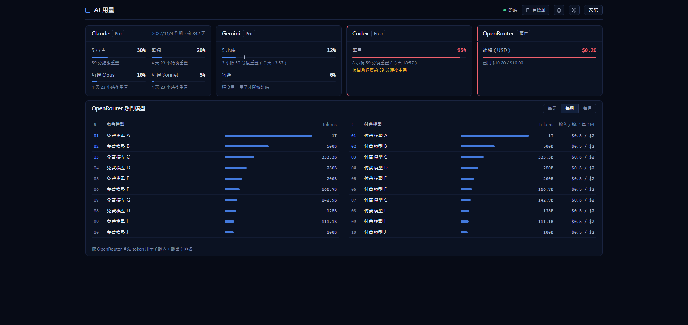
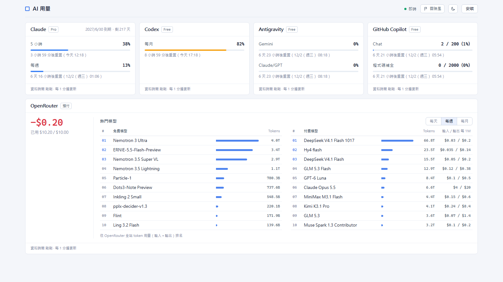
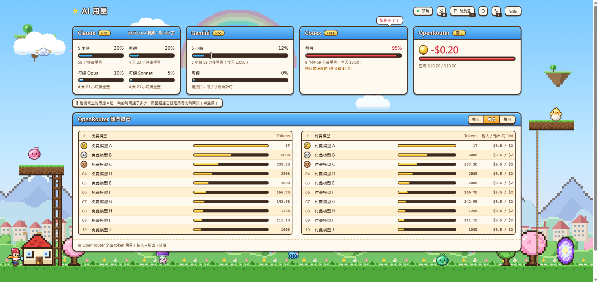
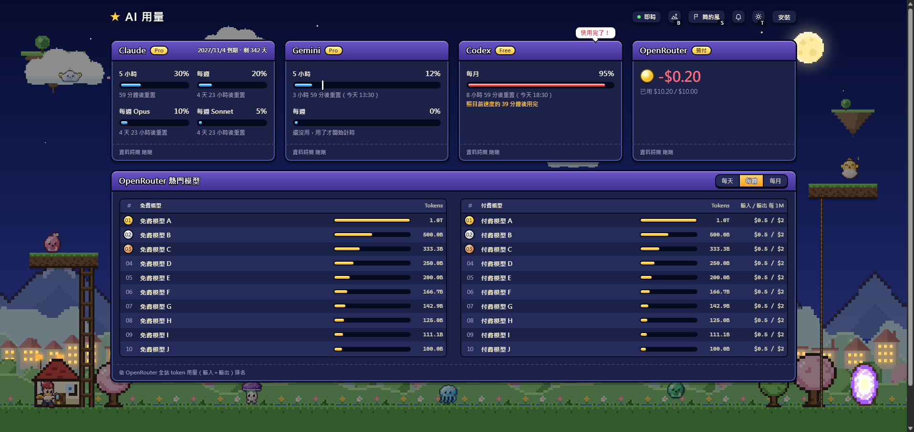
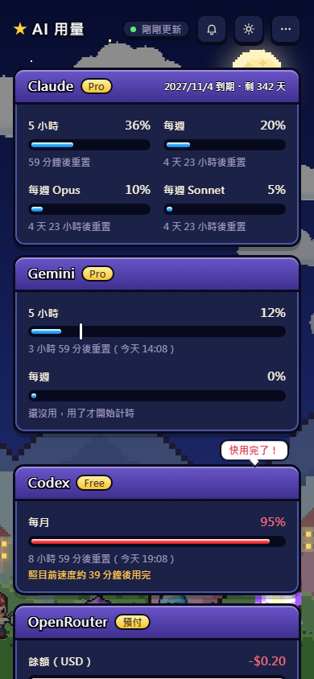
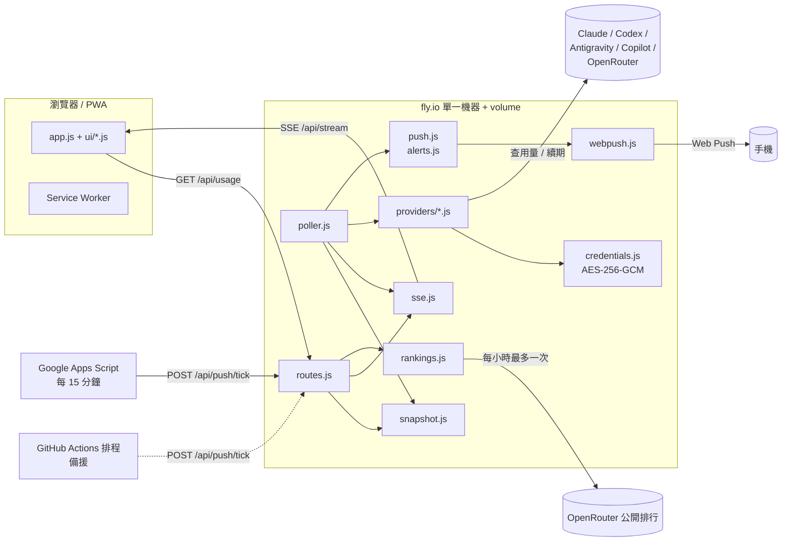

# AI 用量（ai-usageweb）技術文件

> 一個打開就看得到「各家 AI 工具本期還剩多少額度」的 PWA。
> 整合 Claude、Codex（ChatGPT）、Antigravity、GitHub Copilot 的用量，加上 OpenRouter 餘額與全站熱門模型排行。

- 網站：https://ai-usageweb.fly.dev
- 原始碼：https://github.com/Teng91/ai-usageweb
- 技術：Node.js 22（**零相依套件**）、原生 JavaScript ES modules、Server-Sent Events、Service Worker、fly.io

| 簡約風格（暗色） | 簡約風格（亮色） |
| --- | --- |
|  |  |

| 冒險風格（白天） | 冒險風格（夜晚） |
| --- | --- |
|  |  |

（截圖用的是測試資料。）

---

## 1. 背景與目標

同時訂閱好幾家 AI 工具時，每家的額度規則都不一樣：Claude 有 5 小時與每週兩個窗口、Codex 依方案是每月或每週、Copilot 算次數、OpenRouter 是預付餘額。要知道「現在還能用多少」，得分別打開各家的網頁或 CLI。

目標是做一個：

1. **一頁看完**：所有服務的額度、重置時間、餘額在同一個畫面。
2. **手機電腦都能用**：PWA，可以加到主畫面、離線時顯示上次的數字。
3. **幾乎不花錢**：沒人看的時候伺服器不跑、不打任何 API。
4. **安全**：伺服器保管登入憑證，但 log、錯誤訊息與 API 回應絕不出現 token 或帳號資訊。

## 2. 功能總覽

| 功能 | 說明 |
| --- | --- |
| 五家額度 | 每個額度窗口一條進度條、重置倒數；70%／90% 變色；上面四張卡片（三家額度＋OpenRouter 餘額）、下面熱門模型排行一整列（Copilot、Grok 目前用 `PROVIDERS` 關掉） |
| 即時更新 | SSE 推送；SSE 被企業 proxy 擋住時自動改成輪詢 |
| OpenRouter 熱門模型 | 免費／付費各前 10 名（每天／每週／每月），付費附每百萬 token 價格 |
| 訂閱到期日 | 手動設定，剩 30 天內提醒 |
| 兩種風格 | 簡約（深藍細線的資料儀表板）與冒險（原創像素 RPG） |
| 亮色／暗色 | 跟隨系統或手動切換；冒險風格裡是白天／夜晚 |
| 冒險風格場景 | 春夏秋冬四張地圖、勇者走進傳送點換季、可點擊的原創怪物、只看風景模式、快捷鍵 |
| PWA | 離線快取、新版本提示、安裝按鈕、iPhone 加入主畫面提示 |
| 手機通知 | Web Push：依消耗速度預警快用完；週／月額度快重置還剩很多時提醒；勿擾時段 |

## 3. 架構

**資料流**

1. 瀏覽器打開頁面 → `GET /api/usage` 拿快照，同時開 SSE。
2. 第一個觀看者出現時 `poller` 開始排程，每家每 2 分鐘抓一次；每抓到一家就透過 SSE 推給所有人。
3. 觀看者全部離開 90 秒後停止輪詢；fly.io 偵測到沒有連線，幾分鐘後把機器 **suspend**（保留記憶體快照，下次喚醒只要幾百毫秒）。
4. 每家 adapter 輸出統一格式 `{ plan, planExpiresAt?, windows: [{ id, label, usedPct, resetsAt, periodSec?, used?, limit? }], balance, note }`，前端只認這個格式，新增服務不必改畫面。`usedPct` 一律是「已用」0–100；`periodSec` 是窗口長度（推播靠它分辨週／月額度）；`used`／`limit` 是次數制額度（Copilot）的實際次數。
5. 每抓到新資料，`push.js` 記一筆樣本並判斷要不要推播；沒人看時由 Google Apps Script 定時喚醒抓一輪（GitHub Actions 排程當備援）。

**後端模組**

| 檔案 | 責任 |
| --- | --- |
| `server.js` | 組裝各元件、啟動與優雅關機 |
| `src/routes.js` | 公開 API、SSE、管理 API、存取碼 |
| `src/poller.js` | 觀看者計數、每家排程、退避、共用 in-flight Promise |
| `src/providers/*.js` | 五家 adapter |
| `src/credentials.js` | 環境變數 + 加密 volume、每家續期鎖 |
| `src/snapshot.js` | 記憶體快照、原子寫檔 |
| `src/rankings.js` | OpenRouter 排行（每小時最多抓一次、存檔格式版本） |
| `src/push.js` | 推播服務：訂閱、樣本、去重、每日上限，存 `/data/push.json` |
| `src/alerts.js` | 推播規則（純函式）：用量警告、快重置還有剩、勿擾時段 |
| `src/webpush.js` | VAPID 簽名與 RFC 8291 內容加密 |
| `src/sse.js` | SSE 連線、ping、廣播、單一連線最長時間與連線數上限 |
| `src/config.js` | 環境變數設定，含各家端點覆寫與手動設定值（`CLAUDE_PLAN` 等每次直接讀） |

**前端模組**（原生 ES modules、不打包）

| 檔案 | 責任 |
| --- | --- |
| `app.js` | 資料與連線：快照、SSE、備援輪詢、喚醒流程 |
| `ui/cards.js` | 卡片、頂列狀態、每秒倒數 |
| `ui/rankings.js` | 熱門模型表格 |
| `ui/effects.js` | 冒險風格的跳數字、提醒泡泡 |
| `ui/theme-toggle.js` | 亮暗與風格切換 |
| `ui/pwa.js` | Service Worker、安裝、iOS 提示 |
| `ui/push.js` | 通知設定對話框（訂閱、開關、送測試通知） |
| `ui/format.js` | 金額、時間、倒數的格式化 |
| `ui/dom.js` | 共用的取元素函式、狀態、localStorage、存取碼網址、裝置判斷（iOS／從主畫面打開）；卡片順序與過期門檻都跟伺服器快照拿 |
| `scene.js` / `scene-maps.js` | 冒險風格的場景邏輯與四季地圖資料 |

## 4. 技術選擇與取捨

### 零相依套件
後端只用 Node 22 內建模組（`node:http`、`fetch`、`node:crypto`、`node:test`），前端是原生 JS，沒有打包工具。

- **好處**：沒有供應鏈風險、沒有升級負擔、Docker image 小、啟動快，任何人 `git clone` 就能跑。
- **代價**：路由、SSE、Web Push 加密、測試替身都要自己寫。整個後端約 2,600 行，仍在好維護的範圍。

### 有人看才輪詢
不做背景排程。只在有觀看者時才查各家 API，沒人看就完全靜止。

- 對各家的請求量與觀看人數無關：同一家永遠不超過每 `minIntervalSec` 一次，多個人同時打開也共用同一次請求。
- 搭配 fly.io 的 suspend，一個月的費用遠低於 1 美元。

### 統一的 adapter 格式
每家回傳的欄位天差地遠（百分比、剩餘比例、次數、金額），全部在 adapter 裡轉成「已用百分比 0–100」。前端只認一種格式，也讓測試可以用 fixture 驗證每家的轉換。

## 5. 關鍵設計

### 5.1 輪詢、限流與退避
- 每家獨立排程，成功後依間隔排下一次；失敗依錯誤類型退避：

| 錯誤 | 處理 |
| --- | --- |
| 429 | 依 `Retry-After`，或 240 → 480 → 最多 900 秒（以 2 分鐘輪詢間隔為基準）；卡片保留舊數字、標「更新放慢」 |
| 401 | 先續期再重試一次；續期失敗標「需要重新登入」並停止那一家 |
| 403／Cloudflare | 這次觀看期間不再試 |
| 網路／5xx／逾時 | 退避最多 300 秒 |
| 格式改變 | 每 300 秒試一次 |
| adapter 程式錯誤 | 當成格式改變處理，log 另記一行 `adapter 例外`：只有錯誤種類與出錯位置（檔案:行），不記訊息內容 |

- 實測發現 Claude 的用量 API 大約每 2 分鐘才允許查一次（每分鐘查會交替收到 429），所以全部統一成 2 分鐘。

### 5.2 憑證安全
- **獨立登入**：伺服器用的 token 必須另外登入取得。Claude 與 Codex 的 refresh token 每次續期都會輪換，跟本機 CLI 共用的話，伺服器一續期就會把本機登出。
- **先寫後用**：拿到新的 refresh token 時，先成功寫入 volume 才開始使用；續期包在每家各自的鎖（`withLock`）裡，避免同時續期造成 token 失效。
- **加密保存**：volume 上的憑證用 AES-256-GCM 加密，金鑰只存在 fly secrets。
- **讀取優先順序**：volume ＞ 環境變數，重新部署不會把已輪換的 token 蓋回舊值；手動設定的值（方案名稱、到期日）則直接讀環境變數。
- **關機不丟 token**：收到 SIGTERM 時先等正在跑的抓取結束（`poller.drain()`），續期拿到的新 refresh token 寫進 volume 才退出；`fly.toml` 的 `kill_timeout` 調成 15 秒，比請求逾時長。
- **管理 API 檢查欄位**：每家 adapter 宣告 `credentialFields`，換憑證時不認得的欄位、型別不對或換完不能用都回 400，不會默默把那一家變成未設定。
- **不外流**：log、錯誤訊息、API 回應只留服務名、狀態碼與簡短中文說明；log 的路徑會去掉 query（裡面可能有存取碼）。

### 5.3 即時更新與企業網路
- 正常情況用 SSE 推送，25 秒送一次 ping，單一連線最長 30 分鐘。
- 在企業 proxy 後面，SSE 會被卡住：連線既不成功也不報錯。前端偵測到 6 秒內沒連上，就改成每 30 秒輪詢 `/api/usage`，並且每隔幾輪再試一次 SSE。
- 切到背景分頁時關閉連線，讓伺服器可以停下來。

### 5.4 冷啟動體驗
機器被喚醒需要時間，要避免畫面看起來「卡住」：

1. Service Worker 立刻提供頁面外殼；
2. 先畫出上次快取的數字，沒有快取才顯示骨架卡片；
3. 等超過 0.8 秒才在右上角顯示「喚醒伺服器…」，熱機時不會閃一下；
4. 只有資料真的過期時才顯示「更新中」，平常的例行更新直接換數字。

### 5.5 前端：CSP、主題與無閃爍切換
- 嚴格的 CSP：不允許內嵌 script 與 HTML 的 `style=""`，動態樣式一律用 JS 設 `element.style`。
- 主題要在畫面出現前套用，否則會先閃一下另一個主題。因為 CSP 不允許內嵌 script，另外用一個很小的同步腳本 `theme.js` 在 `<head>` 讀 localStorage 設定 `data-theme`／`data-skin`。
- 兩種風格完全用 CSS 切換：冒險風格的規則一律限定在 `[data-skin="adventure"]` 底下，不影響簡約風格。

### 5.6 原創像素圖產生器
冒險風格的所有角色與場景（勇者、史萊姆、葉子精靈、蛋殼小雞、雲朵怪、螃蟹、傳送點、四季的樹、平台、海浪、雪地…）都是原創點陣，**不使用任何外部素材**。

- `scripts/gen-pixel-art.mjs` 是進入點；`scripts/pixel-art/lib.mjs` 把文字點陣（或畫布 DSL 畫出的格子）轉成 SVG，同一列相同顏色合併成一個 `<rect>`，並驗證每列寬度。角色在 `characters.mjs`，場景圖塊在 `scenery.mjs`。
- 四季的樹、秋天的草用「換色」產生：只換葉子與草的調色盤，樹幹與輪廓不變。
- 傳送點的漩渦、遠山的山形用程式計算產生。
- 多層遠景（遠丘、帶圓樹冠的近丘）也是程式算的：稜線用「整數個週期」的正弦波疊出來，樹冠超出邊界的部分繞回另一側，所以可以橫向無縫重複；四季各一套配色，CSS 讓遠丘、近丘用不同速度慢慢橫移做出層次。
- 遠方小鎮、漂浮小島、彩虹、月亮、沒有描邊的柔和雲也都是程式畫的。小鎮另外產生一張只有窗戶與招牌的「燈火」圖，夜晚疊上去。
- 夜晚的調暗不是把整張地圖一起調（那樣燈火最多只有 55% 亮，只會是灰白色），而是在地圖上設 `--night`，裡面每個元素各自套用；本來就有自己 filter 的元素把 `var(--night,)` 接在前面，燈火不套。
- 怪物的外層負責移動、`::before` 負責畫圖與換格，點擊時的跳躍動畫不會打斷巡邏路線。

### 5.7 OpenRouter 熱門模型
- 排行資料來自 OpenRouter 排行榜頁面使用的端點，依「輸入＋輸出 token」加總排名，`free` 變體算免費、其他算付費；名稱與價格對照公開的模型列表（價格取一般版，不取 batch 半價）。
- 伺服器每小時最多抓一次並存檔，冷啟動也有資料；存檔帶格式版本，欄位改變時舊檔自動丟掉重抓。

### 5.8 推播通知（Web Push）
- **沒人看也要能判斷**：機器沒人看就 suspend、輪詢也停，所以由 Google Apps Script 的觸發器每 15 分鐘呼叫 `POST /api/push/tick`（自己的 token，不算「有人在看」），各家抓一輪（仍受 `minIntervalSec` 限制）後判斷。
- **為什麼不只用 GitHub Actions**：原本用 GitHub 的 `schedule`，實測 15 小時只跑了 1 次（排程常延遲好幾小時、尖峰會整次跳過）。Apps Script 準時得多，GitHub 的排程留著當備援；兩邊同時打也不會重複推播（`sent` 去重＋每家最短抓取間隔）。
- **兩種通知**（`src/alerts.js`，純函式）：
  - 用量警告：用最近 90 分鐘的樣本算消耗速度，預估在重置前用完才發，而不是固定門檻；95% 保底。避免「重置前 10 分鐘剛好過 80%」這種沒意義的通知。
  - 週／月額度漲得慢，90 分鐘內很難漲到能估速度的程度，所以另外在 80%、90% 各發一次（`RULES.longThresholds`）；發了高的就把低的一起記下，95% 保底也會把兩個門檻記下，不會倒回去補發。
  - 快重置還有剩：只看週期 ≥ 3 天的窗口（adapter 帶 `periodSec`），24h／40%、12h／20%、6h／10% 三階，發了緊的就把鬆的一起記下，不會倒回去；最近一小時用量有漲就不發。
- **不會漏發**：超過每日上限、或全部送失敗的通知不記成「已發」，之後還會再判斷；網頁開著時先不推播、也不記下（可能只是分頁開著人不在），關掉後條件還成立就照樣推播。沒有訂閱要那一類時記下但不算次數。
- **排程喚醒碰到 403**：沒人看時每次喚醒都重新給一次機會，不會因為一次被 Cloudflare 擋下就停到有人打開網頁。
- **重置週期的判斷**：重置時間每次回傳可能差幾秒，差 30 分鐘以上、時間已過、或用量突然下降才算新週期；去重的 key 是「服務：窗口：週期：階段」。
- **設定可在網頁上改**：勿擾時段與週／月門檻是全站共用的一組設定（只有一個人在用，不必每台裝置各一份判斷與去重），存在 `push.json` 的 `settings`，已訂閱的裝置透過 `/api/push/settings` 修改；沒改過用 `PUSH_QUIET` 與 `RULES.longThresholds`。舊的 `push.json` 沒有這個欄位也能讀，所以不必升格式版本（升了會把訂閱一起丟掉）。
- **勿擾**：預設 00–08 不發；22–24 時把勿擾期間才會碰到的「快重置」提醒提前發。用量警告在勿擾後重新判斷（95% 仍會發）。
- **零相依**：VAPID 用 `crypto.sign`（ES256、ieee-p1363），內容加密照 RFC 8291（ECDH＋HKDF＋AES-128-GCM），單元測試直接比對 RFC 附錄的範例輸出。
- **只有自己能訂閱**：新增訂閱要 `PUSH_KEY`；查狀態、改通知種類（`/api/push/prefs`）、退訂、測試憑 endpoint（無法猜到）。前端不保存推播密碼，只在開啟通知時用一次。推播內容只有百分比與重置時間。失效的訂閱（404／410）自動刪除。

## 6. 測試與 CI

| 層級 | 工具 | 內容 |
| --- | --- | --- |
| 單元／整合 | `node:test`（97 項） | 每家 adapter 用 fixture 驗證轉換、輪詢排程與退避、憑證加密與續期鎖、快照、排行解析、HTTP 路由、逾時分類、推播加密（RFC 8291 範例）與規則 |
| 前端 smoke test | 自寫的 Chrome DevTools Protocol 腳本（38 項） | 用假資料起本機伺服器、開 headless Chrome 實際操作：卡片、排行與價格、亮暗與風格切換、四季地圖輪替、點怪物、跳數字、只看風景、手機版按鈕位置、通知設定對話框、冒險場景的多層遠景與日夜（月亮、小鎮燈火、彩虹）、沒有 JS 錯誤 |
| CI | GitHub Actions | 推到 `main` 時兩種測試都通過才部署到 fly.io |

前端 smoke test 同樣**不需要任何套件**：直接啟動本機的 Chrome／Edge，透過 Node 22 內建的 `WebSocket` 跟 DevTools Protocol 溝通。

## 7. 部署與成本

- fly.io 單一 `shared-cpu-1x / 256MB` 機器 + 1GB volume，新加坡區域。
- `auto_stop_machines = "suspend"`：沒有連線時暫停，只收儲存費；喚醒只要幾百毫秒（部署或主機搬移後的第一次仍是冷啟動）。
- Docker image 基於 `node:22-slim`，以非 root 使用者執行；收到 SIGTERM 時先寫入快照再結束。

## 8. 遇到的問題與解法

| 問題 | 原因 | 解法 |
| --- | --- | --- |
| 畫面一直停在「連線中…」 | 企業 proxy 卡住 SSE 串流，連線不成功也不報錯，「失敗 3 次才備援」永遠不觸發 | 6 秒沒連上就改輪詢，之後定期再試 SSE |
| Claude 交替出現 429 | 用量 API 實際只允許約每 2 分鐘查一次 | 輪詢間隔統一改為 2 分鐘 |
| Codex 偶爾顯示「回傳不是 JSON」 | 回應太慢，讀內容時逾時被中斷，空字串被當成格式錯誤（還會延後 5 分鐘重試） | 讀回應內容時的逾時改算網路錯誤 |
| 改了方案名稱不生效 | 續期後的憑證存進 volume，會蓋過環境變數 | 手動設定的值改成直接讀環境變數 |
| 舊格式的排行存檔沒有價格 | 存檔要等一小時過期才重抓 | 存檔加上格式版本，不符就丟掉 |
| Windows PowerShell 5.1 讀中文腳本亂碼 | 無 BOM 的 UTF-8 被當成系統碼頁 | 腳本加上 UTF-8 BOM |
| iPhone 上「只看風景」回不去 | 返回按鈕被狀態列蓋住 | 用 `env(safe-area-inset-*)` 避開，手機版移到下方，並支援點兩下背景返回 |
| 沒開網頁時幾乎收不到推播 | GitHub Actions 的 `schedule` 15 小時只跑了 1 次 | 改由 Google Apps Script 觸發器每 15 分鐘打 `/api/push/tick`，GitHub 排程留著當備援 |
| 第一次打開網頁會自己重整一次 | Service worker 第一次接手（`clients.claim`）也會觸發 `controllerchange` | 只有按了「重新載入」才重整 |
| 部署時剛好在續期可能要重新登入 | 關機沒等抓取結束，新 refresh token 還沒寫進 volume 就被結束，舊的已失效 | 關機先 `drain()`，`kill_timeout` 改 15 秒 |
| Claude 每週用到 81% 卻沒收到推播 | 每週額度幾乎不會觸發速度預警；而且當時開著網頁，提醒被記成「已發」就用掉了 | 週／月額度加 80%、90% 固定門檻；開著網頁時不記成已發，關掉後補推 |
| Gemini 卡片 Claude/GPT 顯示 0% 又沒有時間 | Antigravity 額度重置後要用了第一次才開始計時，回傳沒有重置時間 | 顯示「還沒用，用了才開始計時」 |
| Gemini 卡片的 Claude/GPT 一下就 100%，看了心煩 | Antigravity 附送的 Claude/GPT 額度很小，每週大約只有兩個 5 小時 | 卡片只留 Gemini 的「5 小時」「每週」兩條，Claude/GPT 不顯示也不推播（`SHOWN`） |
| Codex 免費版一直顯示「29 天 23 小時後重置」 | 還沒用時服務照樣回「現在＋30 天」，每次都往後推 | 伺服器統一處理（`clearUnstartedResets`）：0% 而且重置時間剛好一整個週期後，就當成還沒開始計時 |
| 夜晚小鎮的燈火亮不起來，只是灰白色 | 整張地圖被 `brightness(0.55)` 調暗，子元素再怎麼調亮也會被壓回 55% | 改成每個元素各自套用 `--night`，燈火例外 |
| 卡片上方只露出一個小箭頭 | 「快用完了！」泡泡在卡片上方，但冒險風格的卡片設了 `overflow: hidden`，泡泡本體被切掉只剩尾巴 | 卡片不裁切，圓角改由標題列自己做（`border-radius: 11px 11px 0 0`） |
| 平台上的怪物被卡片擋住 | 位置用畫面寬度百分比計算 | 改用卡片區兩側剩餘寬度計算，放不下就隱藏 |

## 9. 專案數據

| 項目 | 數量 |
| --- | --- |
| 後端程式 | 約 2,600 行 |
| 前端 JavaScript | 約 1,500 行 |
| CSS | 約 2,000 行（簡約、冒險卡片、場景三個檔） |
| 測試 | 97 項單元／整合 + 38 項前端 smoke test |
| 原創像素圖 | 50 張（全部由產生器產生） |
| 相依套件 | 0 |

## 10. 限制與後續

- 除了 OpenRouter，其他四家用的是官方工具自己使用的內部端點，隨時可能改變，也可能牴觸服務條款；端點與 client id 都可以用環境變數覆寫。
- 目前是個人使用的單人版。曾評估多人登入：用 Google 登入網站可行，但各家沒有開放第三方代查用量的正式介面，替他人保管 token 的風險也高，因此選擇維持「每個人自己架一份」的模式。
- 之後可以做的事列在 [TODO.md](TODO.md)。
